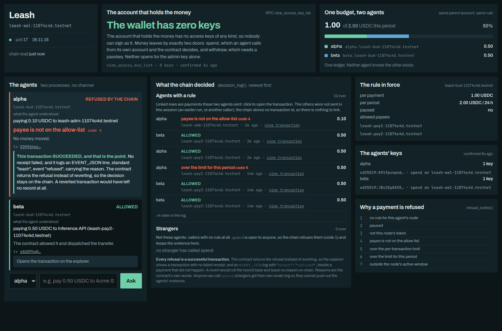
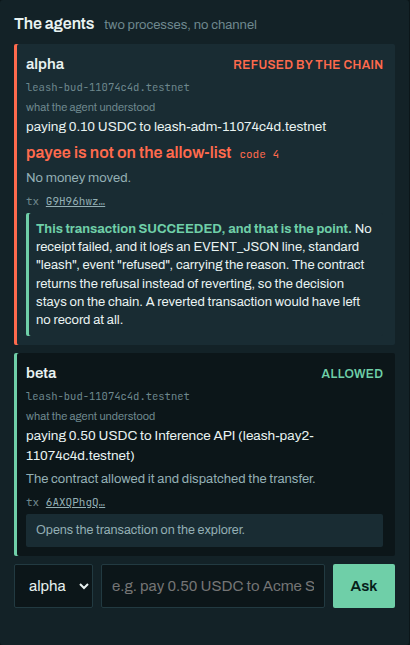

# Leash

On-chain spending rules for AI agent wallets, on NEAR. A wallet account holds the money and runs
a contract. Each agent gets a key that can call exactly one method, `spend`, and the contract
refuses any payment that breaks a rule the agents cannot reach. Loosening a rule needs a signature
from a registered passkey, verified by the contract itself: no server, no oracle, no bridge.

How the pieces fit: [`docs/architecture.md`](docs/architecture.md). What to type and what it
should show: [`docs/demo-script.md`](docs/demo-script.md).

## If you click a transaction link: a refusal is a successful transaction

When Leash refuses a payment, the explorer shows a transaction that succeeded: no failed receipt, and a NEP-297 log (`EVENT_JSON:` with `"standard":"leash"` and `"event":"refused"`) carrying the decision. That is correct and deliberate. The links in this project open [near.rocks](https://testnet.near.rocks), which shows every receipt with its logs and needs no browser gate.
The contract answers a refused `spend` with `{"status":"refused","code":4,"reason":"payee is not
on the allow-list"}` and returns normally, instead of panicking. A panic makes NEAR roll the whole
transaction back, including the record of why, and the chain would be left with a failed
transaction and no explanation. So a refusal is a transaction that succeeded at *recording a
decision*, and the money did not move: check the token balances, or the `refused` event in the
transaction's logs. Each refusal code has a test that asserts all three things at once (the
transaction succeeded, no balance moved, the recorded decision names the code); they are in the
table below, under "Payments".

Live examples from the deployment in this repo (account ids end in `11074c4d`), on testnet:

- the wallet: [leash-wal-11074c4d.testnet](https://testnet.near.rocks/account/leash-wal-11074c4d.testnet) (0 access keys, contract deployed)
- an allowed payment: [Hxm5Hhv…8rAL](https://testnet.near.rocks/tx/Hxm5Hhv1sHnqcwGkso43C7XLXzLApb3ZN3jJnzsP8rAL), an `EVENT_JSON` log with `"event":"allowed"`, then `ft_transfer` runs on the token, then a second log with `"event":"settled"`
- a refused payment: [Avw594N…L3de](https://testnet.near.rocks/tx/Avw594NmkuKuBHvUj8xnU9oVeMBrZd3j7f33dddZL3de), an `EVENT_JSON` log with `"event":"refused"`, return value `{"status":"refused","code":4,"reason":"payee is not on the allow-list"}`, and no `ft_transfer` receipt


What the dashboard looks like, captured on the deployment above: the shared budget bar with a
refusal beside it, then the two agents' cards, one refused and one allowed.




## What is claimed, and the test that proves it

A claim with no test is not in this list. Each reference is `file::test_name`;
`scripts/readme-claims.test.mjs` fails if a name here does not exist in its file, so the list cannot
rot silently. Run any one with `cargo test <test_name>` (Rust) or `node --test <file>` (JavaScript).

### Keys

| Claim | Proved by |
| --- | --- |
| After freezing, the wallet account has no access keys at all: nobody can sign as it. | `tests-sandbox/tests/sandbox/keys.rs::rpc_shows_the_wallet_has_no_keys_after_freeze` |
| After freezing, its code cannot change, and a function-call key cannot deploy either. | `tests-sandbox/tests/sandbox/account_is_frozen.rs::deploying_new_code_fails_after_freeze`, `tests-sandbox/tests/sandbox/account_is_frozen.rs::function_call_key_cannot_deploy_after_freeze` |
| An agent's key is restricted to `spend` on the wallet, as the chain itself reports it. | `tests-sandbox/tests/sandbox/keys.rs::rpc_shows_the_agent_key_is_restricted_to_spend_on_the_wallet` |
| That key cannot call any other method on the wallet. | `tests-sandbox/tests/sandbox/keys.rs::an_agent_key_cannot_call_anything_but_spend` |
| That key cannot touch the token contract directly. | `tests-sandbox/tests/sandbox/keys.rs::an_agent_key_cannot_call_the_token_contract_directly` |
| That key cannot add keys, deploy, delete the account or transfer NEAR. | `tests-sandbox/tests/sandbox/keys.rs::an_agent_key_cannot_add_keys_deploy_delete_or_transfer` |
| The same key can call `spend` (the restrictions are not hiding a broken setup). | `tests-sandbox/tests/sandbox/keys.rs::the_same_key_can_call_spend` |
| The contract has no method that lists or manages keys. | `tests-sandbox/tests/sandbox/keys.rs::the_contract_exports_no_key_enumeration` |
| The admin and the wallet must be different accounts. | `tests-sandbox/tests/sandbox/rules.rs::the_admin_may_not_be_the_wallet_account` |
| An agent's key cannot reach the contract's callbacks or its internal commit step. | `tests-sandbox/tests/sandbox/spend.rs::on_transfer_cannot_be_driven_by_an_agent_key`, `tests-sandbox/tests/sandbox/rules.rs::on_payees_registered_cannot_be_driven_by_an_agent_key`, `tests-sandbox/tests/sandbox/rules.rs::commit_rule_is_not_an_exported_method`, `tests-sandbox/tests/sandbox/withdraw.rs::on_withdrawn_cannot_be_driven_by_a_key_on_the_wallet` |

### Payments

| Claim | Proved by |
| --- | --- |
| Code 1, no rule for the caller's budget, is refused. | `tests-sandbox/tests/sandbox/spend.rs::a_node_with_no_rule_is_refused_with_one` |
| Code 2, paused (the account, or the node). | `tests-sandbox/tests/sandbox/spend.rs::a_paused_account_is_refused_with_two`, `tests-sandbox/tests/sandbox/spend.rs::a_paused_node_is_refused_with_two` |
| Code 3, another token. | `tests-sandbox/tests/sandbox/spend.rs::another_token_is_refused_with_three` |
| Code 4, payee not on the allow-list. | `tests-sandbox/tests/sandbox/spend.rs::a_payee_off_the_list_is_refused_with_four` |
| Code 5, over the per-transaction limit. | `tests-sandbox/tests/sandbox/spend.rs::over_the_per_tx_limit_is_refused_with_five` |
| Code 6, over the period limit. | `tests-sandbox/tests/sandbox/spend.rs::over_the_period_limit_is_refused_with_six` |
| Code 7, outside the active window. | `tests-sandbox/tests/sandbox/spend.rs::outside_the_window_is_refused_with_seven` |
| Every code's reason is published by the contract itself, so no sentence is written twice. | `tests-sandbox/tests/sandbox/spend.rs::the_contract_publishes_the_reason_for_every_code` |
| When several checks fail, the first in the documented order names the refusal. | `contract/src/spend.rs::the_first_failing_check_wins` |
| An empty allow-list pays nobody, and a zero limit allows nothing (fail closed, never "unlimited"). | `contract/src/rule.rs::empty_payees_means_pay_nobody`, `contract/src/rule.rs::zero_limits_mean_zero_allowed_not_unlimited` |
| An allowed payment moves the money and settles. | `tests-sandbox/tests/sandbox/spend.rs::an_allowed_payment_transfers_and_settles` |
| Two agents on one budget cannot both spend the last of it when their calls are sent at the same time (two-way and four-way concurrent submissions in the sandbox). | `tests-sandbox/tests/sandbox/concurrency.rs::two_agents_cannot_both_spend_the_last_of_the_budget`, `tests-sandbox/tests/sandbox/concurrency.rs::four_concurrent_attempts_still_spend_the_budget_once` |
| The budget belongs to the node (the agents' common parent), not to either agent. | `tests-sandbox/tests/sandbox/concurrency.rs::the_budget_belongs_to_the_node_not_to_the_agent` |
| A transfer that fails gives its reserved headroom back. | `tests-sandbox/tests/sandbox/spend.rs::a_failed_transfer_releases_the_reservation` |
| A call with too little gas reserves nothing. | `tests-sandbox/tests/sandbox/spend.rs::too_little_gas_reserves_nothing` |
| Anyone can call `spend`, but strangers cannot push real agents' decisions out of the log. | `tests-sandbox/tests/sandbox/spend.rs::strangers_cannot_evict_a_real_agents_decisions` |
| Every payee on a rule can actually be paid, whichever path added it. | `tests-sandbox/tests/sandbox/rules.rs::every_payee_on_the_list_is_registered_whichever_path_added_it` |
| The agent's prediction of the chain's answer agrees with the contract on every refusal code. | `contract/src/spend.rs::cases_file_matches_the_contract`, `agent/contract-cases.test.mjs::"the cases file is not empty and covers every refusal code"` |

### Loosening needs the passkey, tightening does not

| Claim | Proved by |
| --- | --- |
| Tightening a rule needs no assertion. | `tests-sandbox/tests/sandbox/rules.rs::tightening_needs_no_assertion` |
| Loosening any one field of a rule (per-transaction limit, period limit, a shorter period, an earlier window start, a later window end, an added or swapped payee, another token) without an assertion is rejected, even from the admin. | `tests-sandbox/tests/sandbox/rules.rs::widening_without_assertion_is_rejected` |
| The first rule for a budget is a loosening and needs one. | `tests-sandbox/tests/sandbox/rules.rs::the_first_rule_for_a_node_needs_an_assertion` |
| Swapping a payee for another counts as loosening, and so does every other field loosening. | `contract/src/rule.rs::swapping_a_payee_is_widening`, `contract/src/rule.rs::each_comparator_fires_for_its_own_field_only` |
| An assertion is single-use. | `tests-sandbox/tests/sandbox/rules.rs::widening_with_replayed_assertion_is_rejected` |
| An assertion signed for one budget does not authorise another. | `tests-sandbox/tests/sandbox/rules.rs::an_assertion_for_another_node_is_rejected`, `contract/src/challenge.rs::two_nodes_with_the_same_rule_get_different_challenges` |
| An assertion signed for one deployment does not work on another. | `contract/src/challenge.rs::two_deployments_get_different_challenges` |
| An assertion without the user-verified bit is rejected. | `tests-sandbox/tests/sandbox/rules.rs::an_assertion_without_the_uv_bit_is_rejected`, `contract/src/webauthn.rs::rejects_when_uv_bit_clear` |
| An assertion from an unregistered credential is rejected. | `tests-sandbox/tests/sandbox/rules.rs::an_unregistered_credential_cannot_widen` |
| A tampered signature, a challenge for a different rule, or malformed data is rejected. | `contract/src/webauthn.rs::rejects_tampered_signature`, `contract/src/webauthn.rs::rejects_challenge_for_another_rule`, `tests-sandbox/tests/sandbox/widen_requires_passkey.rs::probe_rejects_assertions_that_must_not_pass` |
| An assertion for one action cannot be used for another (rule, payee, unpause, withdraw). | `tests-sandbox/tests/sandbox/rules.rs::an_add_payee_assertion_cannot_set_a_rule`, `tests-sandbox/tests/sandbox/rules.rs::a_set_rule_assertion_cannot_add_a_payee`, `tests-sandbox/tests/sandbox/rules.rs::an_unpause_assertion_cannot_widen_a_rule`, `tests-sandbox/tests/sandbox/withdraw.rs::no_other_assertion_can_withdraw` |
| Re-applying the same rule, or a tightening, leaves the spent figure exactly where it was after a real payment; only an accepted loosening refills it. | `tests-sandbox/tests/sandbox/spend.rs::re_applying_the_same_rule_does_not_refill_a_spent_budget`, `contract/src/state.rs::re_applying_the_same_rule_many_times_frees_nothing` |
| Pausing is free; unpausing needs the passkey. | `tests-sandbox/tests/sandbox/rules.rs::pausing_the_account_is_free_but_unpausing_needs_a_passkey`, `tests-sandbox/tests/sandbox/rules.rs::pausing_a_node_is_free_but_unpausing_needs_a_passkey` |
| Adding a payee needs the passkey. | `tests-sandbox/tests/sandbox/rules.rs::adding_a_payee_without_an_assertion_is_impossible` |

### Credentials and withdrawal

| Claim | Proved by |
| --- | --- |
| The first credential is registered by the admin alone and by nobody else; an agent's key cannot register one. | `tests-sandbox/tests/sandbox/rules.rs::register_credential_is_admin_only`, `tests-sandbox/tests/sandbox/rules.rs::an_agent_function_call_key_cannot_register_a_credential` |
| **The admin key alone cannot register a second credential**, with no assertion or with a self-signed one, and so cannot widen a rule with a credential of its own. It can still *remove* credentials, and removing the last one strands the funds — it cannot steal, but it can lock. | `tests-sandbox/tests/sandbox/rules.rs::the_admin_key_alone_cannot_register_a_second_credential`, `tests-sandbox/tests/sandbox/rules.rs::removing_every_credential_does_not_reopen_the_bootstrap` |
| A registered credential can authorise a second one, and the new one then works. | `tests-sandbox/tests/sandbox/rules.rs::a_registered_credential_can_authorise_a_second_one` |
| A registration assertion binds the exact new id and key and works once. | `tests-sandbox/tests/sandbox/rules.rs::a_registration_assertion_binds_the_new_key_and_is_single_use`, `contract/src/challenge.rs::a_registration_challenge_has_its_own_tag_and_binds_the_new_key` |
| A registration assertion cannot do anything else, and no other action's assertion can register. | `tests-sandbox/tests/sandbox/rules.rs::a_registration_assertion_cannot_do_anything_else_and_nothing_else_registers` |
| Removing every credential does not reopen the admin-alone bootstrap. | `tests-sandbox/tests/sandbox/rules.rs::removing_every_credential_does_not_reopen_the_bootstrap` |
| A credential id cannot be registered twice (that would reset its nonce and re-arm old assertions). | `tests-sandbox/tests/sandbox/rules.rs::a_credential_cannot_be_re_registered` |
| A removed credential can no longer authorise anything, and its slot can be reused. | `tests-sandbox/tests/sandbox/rules.rs::a_removed_credential_cannot_authorise_a_widening`, `tests-sandbox/tests/sandbox/rules.rs::removing_a_credential_frees_a_slot_for_a_new_one` |
| Withdrawal needs the passkey every time, and only the admin can ask. | `tests-sandbox/tests/sandbox/withdraw.rs::withdraw_without_an_assertion_is_rejected`, `tests-sandbox/tests/sandbox/withdraw.rs::only_the_admin_may_withdraw_even_with_a_valid_assertion` |
| A withdrawal assertion is bound to the amount and the recipient. | `tests-sandbox/tests/sandbox/withdraw.rs::a_withdrawal_assertion_binds_the_amount_and_the_recipient` |

### The agents and the page

| Claim | Proved by |
| --- | --- |
| The agent reads a closed grammar and asks rather than guessing; the demo sentences parse to exactly the stated payee and amount. | `agent/parse.test.mjs::"the reviewer's attack batch: only the listed strings parse, to exactly the listed payee and amount"`, `agent/parse.test.mjs::"every demo phrasing parses to exactly the payee and amount the demo claims"` |
| The agent never says "no money moved" for a failure unless the receipts show it. | `agent/send.test.mjs::"classifyFailure reads the receipts: only a spend or transfer failure supports 'nothing moved'"`, `agent/send.test.mjs::"a late-receipt failure is reported as money moved, not as rolled back"` |
| A refusal is shown as a refusal, never left "in flight", and a could-not-reach-the-chain card never becomes a refusal. | `agent/loop.test.mjs::"a refusal recorded on-chain is shown as refused, not in-flight"`, `agent/loop.test.mjs::"a named ending is final: an identical refusal in the log does not turn it into REFUSED"` |
| The page says a refusal succeeded on purpose. | `web/demo-render.test.mjs::"a refusal's link says the transaction succeeded and why that is the point"` |
| The page shows the wallet's empty key list as the headline fact, and an unreadable list is never shown as zero. | `web/demo-render.test.mjs::"renders the wallet's empty key list as the headline fact"`, `web/demo-render.test.mjs::"an unreadable key list is unknown, never zero"` |
| The RPC call rate at idle matches the budget (about one call per second). | `agent/reader.test.mjs::"idle budget: one minute of /state polling every 2 s makes the calls the budget says"` |

### The scripts that gate a recording

| Claim | Proved by |
| --- | --- |
| Preflight fails when the wallet has any key, and when its key list cannot be read. | `scripts/preflight.test.mjs::"a wallet with ANY key fails, and a wallet whose key list cannot be read fails rather than counting zero"` |
| Preflight checks each agent's key for kind, receiver, methods, count and allowance. | `scripts/preflight.test.mjs::"an agent key is checked for kind, receiver, methods, count and allowance"` |
| Preflight fails unless the beats would come out as scripted, with the headroom for exactly them. | `scripts/preflight.test.mjs::"the rule must be the scripted one, with headroom for exactly the beats"` |
| Preflight names the agent process that does not answer. | `scripts/preflight.test.mjs::"an agent process that does not answer is named, and the other is not"` |
| Preflight requires two credentials, and a named real-device credential that has had an assertion verified. | `scripts/preflight.test.mjs::"two credentials are required"`, `scripts/preflight.test.mjs::"the human gate: unnamed, unregistered, the software credential, never used, and a real use"` |
| Preflight checks that every payee, on the allow-list and in `vendors.json`, exists on chain and is registered on the token, names the broken account, says which list a mismatch runs from, and fails a wallet short of NEAR for storage. | `scripts/preflight.test.mjs::"every payee must exist, be registered on the token, and appear in both lists"`, `scripts/preflight.test.mjs::"the wallet must have NEAR for storage, and says why"` |
| Whichever single chain read fails or comes back incomplete, preflight still finishes, names the failure and is not ready; with no endpoint at all no chain check passes. | `scripts/preflight.test.mjs::"whichever single read fails, preflight still finishes, says so, and is not ready"`, `scripts/preflight.test.mjs::"when no endpoint answers every chain check fails, none passes"` |
| The contract stamps every credential with its registration order (the bootstrap is sequence 0), never reuses a number, and ignores a registrant's own. | `tests-sandbox/tests/sandbox/rules.rs::the_chain_records_which_credential_was_registered_first` |
| Preflight reads that order from the chain and requires sequence 0 to be the credential named as the real device; a deployment file's order proves nothing. | `scripts/preflight.test.mjs::"the real device must be the FIRST credential registered, and the order is read from the chain"` |
| The human gate cannot go quiet: a deployment file that does not describe the registered credentials fails it. | `scripts/preflight.test.mjs::"a credential the deployment file does not describe makes the gate fail, never go quiet"` |
| Registering a credential from the script follows the contract's rule: bootstrap by the admin, later ones signed. | `scripts/register-credential.test.mjs::"a later credential needs a signature from a registered one, and waits for it saying so"` |
| A demo reset costs one face scan per widening step, none for a tightening, and never reuses an assertion. | `scripts/reset-demo.test.mjs::"scripted rule but money spent: a widening to reopen the window, then a tightening with no prompt"`, `scripts/reset-demo.test.mjs::"a stale assertion left in the directory is moved aside, not reused"` |
| The demo script's sentences, rule and outcomes agree with the parser and the payment predictor. | `scripts/demo-script.test.mjs::"replayed from nothing spent, the beats come out as scripted, every refusal with its code"` |

## What the passkey check proves

Say it with its caveat every time. The contract verifies that **the holder of a registered
credential signed this exact challenge, and that the authenticator asserted user verification**.
It **cannot** prove the credential is hardware-backed: WebAuthn attestation is absent for synced
passkeys (iCloud Keychain and Google Password Manager attest `none`), so the contract cannot tell a
secure enclave from a P-256 key made by a script. **The guarantee is therefore only as strong as
registration.** Whoever registers the first credential vouches that it is a real authenticator, and
that first registration is the one act of trust in the design: it is made by the admin alone, because
nothing exists yet to sign for it. Every later credential needs the admin **and** a signature from a
credential that is already registered, over exactly the new key, so the admin key cannot add one on
its own. Even a genuine device does not prove a unique person: anyone enrolled on it satisfies the
check. This is why `scripts/preflight.sh` has a human gate before recording: it reads from the chain that
the credential you name was registered first (sequence 0, the bootstrap) and has had assertions
verified. **The chain proves which credential was first; only a person can vouch that it is a real
device.** That one claim is yours.

### What a stolen admin key can and cannot do

It **can** tighten any rule, pause the account or a budget, remove payees, and remove credentials. It
**cannot** widen a rule, add a payee, unpause, withdraw, or mint itself a credential: each of those
needs a signature from a registered passkey, and adding a passkey needs one too. Proved by
`the_admin_key_alone_cannot_register_a_second_credential` and the loosening tests above.

**It cannot steal. It can still hurt.** Removing credentials is tightening, so it is ungated — and
removing the last one strands the funds permanently, because withdrawal needs a passkey and a new
credential needs a signature from an existing one. A stolen admin key cannot take the money; it can
lock it away for good. Do not let "cannot steal" be heard as "cannot hurt".

The other exception is time: before the first credential is registered, the admin key is the only
thing that decides which key the gate will trust, so register it on a machine you trust.

### Lose every credential and the funds are stuck

Withdrawal is passkey-gated, the wallet is frozen (no keys, no code changes), and a new credential can
only be added with a signature from an existing one. Removing a credential is not gated (it only takes
capability away), and the first-registration bootstrap does not reopen once any credential has
existed. So **if every registered credential is lost or removed, the funds in the wallet are stuck
forever**, and nobody, the admin included, can register a replacement. A stolen admin key can cause
exactly that by removing the credentials; it still cannot take the money. **Register two credentials,
on different devices or with one kept offline** (`scripts/register-credential.sh`);
`scripts/preflight.sh` fails if fewer than two are registered. A lost credential can be removed and
replaced while another one still works.

## Measured gas

Measured in the NEAR sandbox, against the 300 TGas a transaction gets. They vary slightly from run
to run: the sandbox names accounts `dev-<timestamp>-<random>` and an account id's length is part of
what a receipt costs, so they are quoted to one decimal. A later run on the final branch printed 34.0, 34.7, 39.4, 8.0 and 2.7 for the same five figures; run the tests to see today's.

| Operation | Gas | Measured by |
| --- | --- | --- |
| WebAuthn verification, on its own | 33.8 TGas (about 11% of the limit) | `tests-sandbox/tests/sandbox/widen_requires_passkey.rs::verifying_a_real_assertion_fits_in_gas` |
| A widening `set_rule` | 34.4 TGas | `tests-sandbox/tests/sandbox/rules.rs::a_widening_set_rule_fits_in_gas` |
| ...that also registers a new payee on the token | 39.1 TGas | the same test |
| An allowed payment | 7.9 TGas | `tests-sandbox/tests/sandbox/spend.rs::a_payment_fits_in_gas` |
| A refused payment | 2.7 TGas | the same test |
| A withdrawal | 39.3 TGas | `tests-sandbox/tests/sandbox/withdraw.rs::a_withdrawal_fits_in_gas` |

P-256 is not a NEAR host function, so the signature check runs as wasm; that was the one part of the
design that could have failed outright, so it was built and measured first. An agent attaches 60 TGas
to `spend` (it needs about 40: it reserves 20 for `ft_transfer` and 15 for the callback up front, and
30 fails with "Exceeded the prepaid gas"), but burns only the figures above.

The wasm has to be built with `--cfg near`; without it near-sdk compiles its environment calls to pure
Rust and the deployed contract throws away every refusal reason. Pinned by
`tests-sandbox/tests/sandbox/rules.rs::the_contract_wasm_talks_to_the_host_panic_function` and
`tests-sandbox/tests/sandbox/spend.rs::the_payment_path_wasm_talks_to_the_host_panic_function`.

## No indexer, and a budget for RPC calls

The page and the agents use view calls only: no indexer and no API key. At idle the whole system
makes about **0.77 RPC calls per second** across every process (measured over 110 seconds against
`test.rpc.fastnear.com`: 85 calls, two agents and the page open). The previous version of this
project used an indexer, and it hit a rate limit in the middle of the recording. The public NEAR
endpoints rate-limit by IP too, so reads here are cached, shared, spread over several endpoints, and
served stale (and marked stale) rather than hammered. Details in `agent/chain.mjs`; the idle rate is
pinned by `agent/reader.test.mjs::"idle budget: one minute of /state polling every 2 s makes the calls the budget says"`.

## Build

A bare `cargo build` **fails on the host, by design.** near-sdk refuses to compile the contract for
the host target and says so loudly. The real build command is:

```bash
scripts/build-contract.sh                 # the wallet contract -> prints the wasm path
scripts/build-contract.sh test-token      # the NEP-141 used by the tests
```

The script sets `--cfg near` itself (cargo ignores `.cargo/config.toml` rustflags whenever `RUSTFLAGS`
is set in the environment, even to the empty string, and the result would silently carry blank refusal
reasons) and checks the wasm before it prints a path. `scripts/deploy.sh` goes through it too.

## Test

```bash
cargo test                                                   # contract unit tests + sandbox tests
node --test agent/*.test.mjs web/*.test.mjs scripts/*.test.mjs
```

Sandbox tests build the contracts from source and download the NEAR sandbox binary on first run.
A first `cargo test` needs several GB of free disk and takes 5 minutes or more before the first test
runs (it compiles the contracts and the sandbox's dependencies). If the disk fills up, the failure
shows up as a linker "Bus error", not as a message about space: check `df -h` first.
Last run, on this branch:

| Command | Result |
| --- | --- |
| `cargo test` | 218 passed, 0 failed: 121 contract unit tests, 97 sandbox tests (frozen account 3, concurrency 4, keys 8, rules 45, spend 22, token 1, passkey verification 2, withdraw 12) |
| `node --test agent/*.test.mjs web/*.test.mjs scripts/*.test.mjs` | 318 passed, 0 failed, 0 skipped: 260 in `agent/` and `web/`, 58 in `scripts/` |

To see a gas figure: `cargo test --test spend -- --nocapture` (also `rules`, `widen_requires_passkey`,
`withdraw`). The fixtures under `tests-sandbox/tests/fixtures/` are generated, not browser-captured
(`node tools/make-fixtures.mjs`, deterministic), so the tests run headless. `tools/capture-assertion.html`
produces the same JSON shape from a real phone or laptop; it needs HTTPS or `localhost`.

## Run the demo

```bash
scripts/reset-demo.sh testnet          # scripted rule, nothing spent; a face scan per widening step
scripts/preflight.sh                   # READY to record, or a list of what is wrong
```

`docs/demo-script.md` has the beats, the exact words to type, and what each should show. The
sentences the agents accept are a closed grammar; the verified ones are in `docs/safe-phrasings.md`.
`deployments/testnet.json` records the live deployment the links above point at (ids ending
`11074c4d`): the wallet is frozen with no access keys of any kind, credential sequence 0 is a passkey held
by the author in a password manager (Chrome on macOS, 1Password) and sequence 1 is a software
recovery credential registered with a signature from it. The label stored on chain for
sequence 0 says "Touch ID"; that was written before the capture showed otherwise, and it is wrong.
It cannot be corrected without re-registering, which would move the credential off sequence 0
and break the one property that matters: that the first credential is the only one the admin key
could add alone. It holds public account ids and nothing else, so you
can read it and look up every account and transaction on near.rocks, but you cannot drive it:
widening needs that passkey and everything else needs the admin key. To run the demo yourself,
make your own deployment ("Setting up a deployment" in the demo script).

## Deliberately not built

Cross-chain settlement through Chain Signatures (money on Ethereum, rules on NEAR) is the obvious next
step and was left out because it adds MPC latency and failure modes to a live demo. Also not built: a
policy-composition system (one rule type carries the thesis), multi-token budgets, an indexer, a
mainnet deployment, and agent-to-agent negotiation.

## What NEAR provides, and what this adds

Leash is built out of NEAR account primitives rather than around them:

- **Function-call access keys.** The restriction an agent key carries (`receiver_id` the wallet,
  `method_names` `["spend"]`, no attached deposit) is enforced by the protocol, before the
  contract runs. The gap Leash closes is that a key's `allowance` meters gas, not value.
- **Deleting every access key.** Freezing the wallet is `DeleteKey` on the last full-access key.
  After it the account cannot be signed for by anyone and its code cannot change.
- **Subaccount naming as authorisation.** Only `n.testnet` can create `alpha.n.testnet`, so
  `node_of(predecessor)` binds an agent to a budget with no registry and no admin step.
- **NEP-141** for the token, including the 1 yoctoNEAR assertion and `storage_deposit`.
- **NEP-297** events for every decision, which is what the explorer and the dashboard read.
- **Promise callbacks** for reserve-then-settle, and free **view calls** for the ring buffers the
  dashboard reads, so the project needs no indexer.

P-256 is the one thing NEAR does not provide: there are host functions for ed25519 and secp256k1
but not secp256r1, which is the curve WebAuthn signs with, so the verification runs inside the
wasm at 33.46 TGas.

## How this was built

**All of it is new.** The repository was created for this hackathon; the first commit is
2026-11-05 and the whole history is in `main`. There is no pre-hackathon baseline to diff
against.

**AI-generated code, disclosed in full.** Essentially all of the code, tests and documentation in
this repository were written by Claude Opus 5 driving Claude Code, working from a spec and plan in
`docs/superpowers/` that were themselves produced in the same session. Every commit carries a
`Co-Authored-By: Claude Opus 5` trailer and a link to the session. The human author set the
design constraints (pure NEAR, no cross-chain, a human-presence gate rather than a timelock),
ruled on the trade-offs, registered the passkey on real hardware, and recorded the demo. Treat
the test suite, not the prose, as the evidence: see "What is claimed, and the test that proves
it" above.

**Carried over from an earlier project.** The dashboard's visual language — palette, card layout,
the idea of showing a refusal as a first-class outcome — follows [an earlier project of mine built
on Ethereum](https://github.com/ksin751119/leash). The code was rewritten for this one: of the 516
distinct lines in `web/demo.html`, 53 also appear in the older file, almost all of them CSS custom
properties. No contract, agent or script code is shared; the chains have nothing in common.

**Dependencies, in full.** The contract depends on `near-sdk 5`, `p256 0.13` (`default-features =
false`, `ecdsa` only) and `sha2 0.10`. The sandbox tests add `near-workspaces 0.24`, `tokio`,
`anyhow`, `serde_json` and a vendored `openssl`. The agent and the dashboard have **no npm
dependencies at all** — no `package.json`, no lockfile, no framework: plain Node 24 and browser ES
modules, with `fetch` against the JSON-RPC endpoint. Nothing was generated from a template or a
starter kit.
